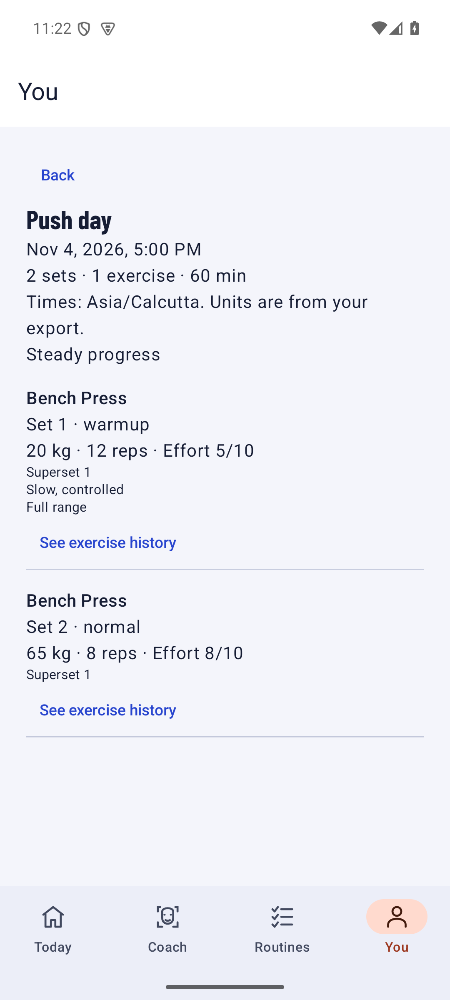
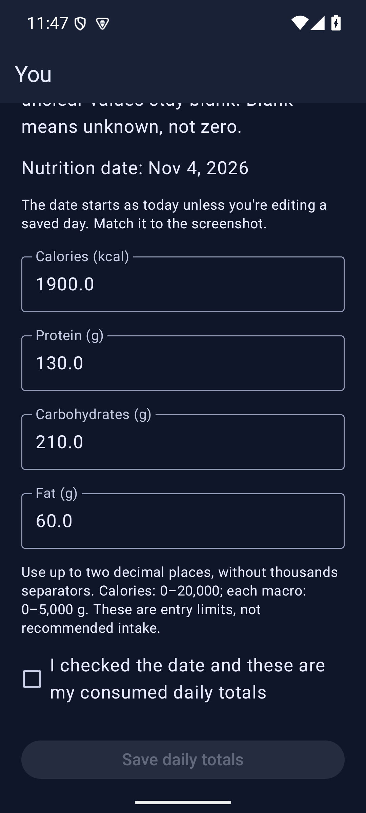

<div align="center">

# Aesthory

**Your looksmaxing routine. Your training log. Your private progress journal.**

A personal Android app for skin, hair, facial aesthetics, physique, and the habits that tie them together.

  

[Get the Android APK](https://github.com/chittranshsharma/Aesthory/actions/workflows/android.yml)

</div>

## Make the routine yours

Open **Today** to see what’s due, start a timer, or log a quick check-in. Build a routine around your own schedule or pick a starter routine from **Coach**. Set weekly targets for completed habits and time spent, then see how the week actually went.

- **Build detailed routines.** Give each habit its own schedule, category, instructions, duration, and tracking method. Add a shorter version for busy days and link products or references where you’ll need them.
- **Stay on schedule.** Set reminders with quiet hours and snooze. Pause and resume habit timers, pick up after restarting the app, and review elapsed time before logging it.
- **Get practical coaching.** Browse built-in guides for skin, hair, style, and physique. The on-device face check measures visible proportions from a selfie, gives framing feedback, and suggests styling options based on your goal.
- **Keep a product and reference library.** Save products, dated observations, web links, and notes imported from text or Markdown. Reuse them across routines.

## Keep your steps in view

Connect Health Connect under **You → Daily steps** to see seven days of activity from your connected fitness apps. Refresh for updated totals, see when they were checked, and manage access through Health Connect. Daily totals follow Health Connect’s source priorities for overlapping activity.

## Bring your training and nutrition together

<table>
<tr>
<td align="center" width="50%"><strong>Workout history</strong><br></td>
<td align="center" width="50%"><strong>Nutrition review</strong><br></td>
</tr>
</table>

**Workouts.** Import a Hevy workout CSV under **You → Workouts**. Review dates, units, exercises, sets, and notes before saving. Repeat imports skip unchanged sessions. Corrected sessions show a comparison and ask you to confirm the replacement.

**Nutrition.** Pick a screenshot under **You → Nutrition**. Aesthory reads calories, protein, carbs, and fat on your phone. Check the date, correct any numbers, and save. You can also enter totals by hand. Each date holds one daily snapshot, and repeated screenshots are detected.

## Keep progress private

Save progress photos with dates, views, and notes, then compare earlier and later entries side by side. Your records live on your phone, and setup works without an account or API key. Built-in coaching, photo checks, and screenshot reading run on the device.

Share a readable routine or an importable routine pack with a friend while keeping your private history separate. Use **You → Backup & restore** to make a password-protected copy of your records and progress photos before moving to another phone. Keep the backup password with your recovery materials.

## Install on Android

1. Open the [Android builds](https://github.com/chittranshsharma/Aesthory/actions/workflows/android.yml) and select a successful run on `main`.
2. Download the **aesthory-debug** artifact, unzip it, and open the APK on your Android phone.
3. Pick your focus in Aesthory and add your first routine.

Requires **Android 9 or newer**. GitHub may ask you to sign in to download the build artifact.

## Build from source

Use **JDK 21** and **Android SDK platform 37** with **Build Tools 36.0.0**. Set `JAVA_HOME` and point `ANDROID_HOME` or the ignored `local.properties` file at your Android SDK.

```powershell
.\gradlew.bat :app:assembleDebug :app:testDebugUnitTest :app:lintDebug
```

On macOS or Linux, use `sh ./gradlew` with the same tasks. The APK is written to `app/build/outputs/apk/debug/app-debug.apk`.

The bundled MediaPipe landmark model carries source and license information in [model assets](app/src/main/assets/models/). Barlow Condensed is distributed under the [SIL Open Font License](app/src/main/assets/licenses/Barlow-OFL.txt). The Gradle wrapper includes its [Apache 2.0 license](gradle/wrapper/LICENSE).
